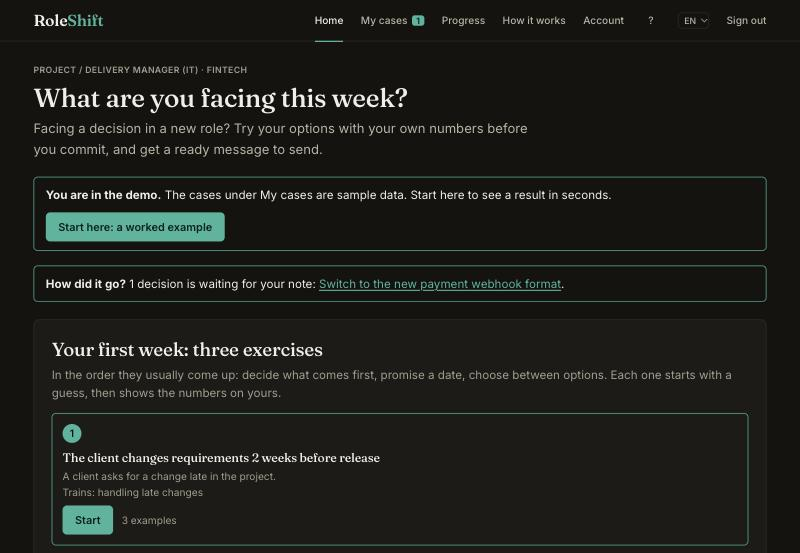
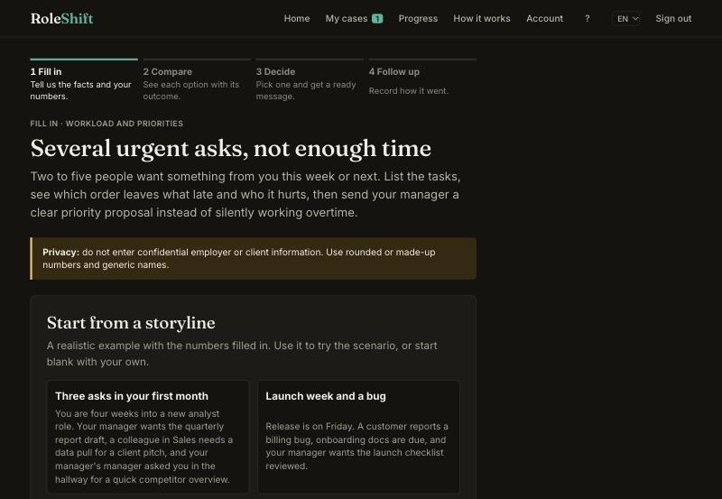
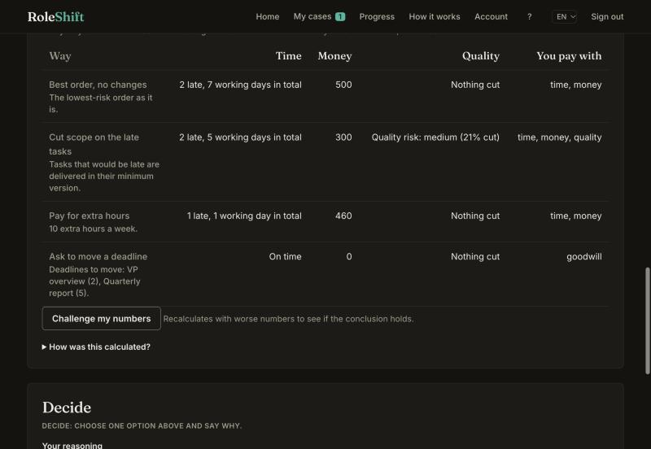
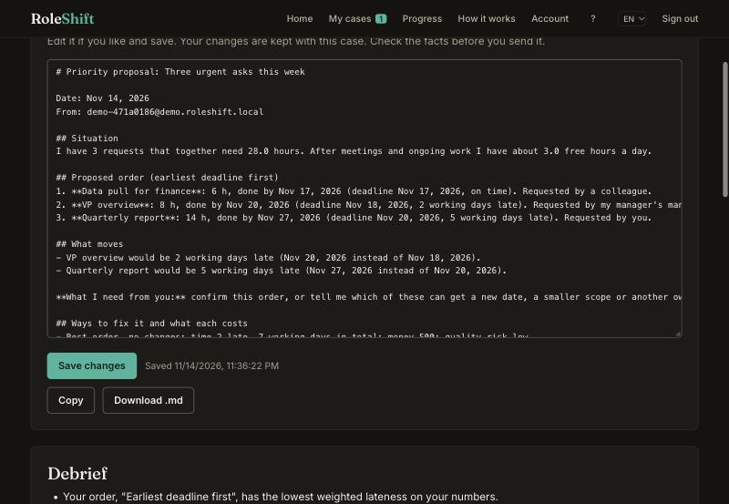
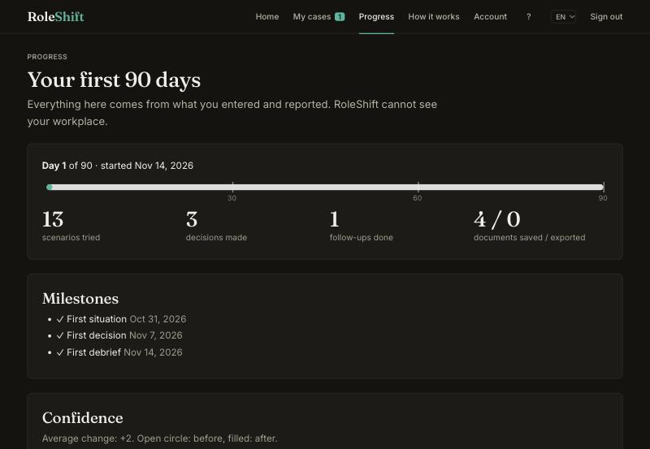

# RoleShift: how to use it

A judgement trainer for the newly promoted. You enter **your own** numbers, make a **guess** first, then see a calculation, decide, get a ready message or document, and later record how it went. The calculation is deterministic: it is not a forecast or advice, and the decision is yours.

Test site: https://businesscup-2-0-zimran.vercel.app (language switch at the top right: EN / RU / KZ).

## 1. Sign in
Press **"Try the demo"** on the sign-in page: a demo account with examples opens, no sign-up needed. For your own account use an email and password, then pick your position and time in role (this chooses examples and wording).

## 2. Pick a situation
Home shows three "first week" exercises: a client change request, several urgent asks, "when will it be done?". **"Start here: a worked example"** shows a result in seconds. Not sure which fits? Describe it in your own words under "Describe your scenario".

## 3. Enter your numbers
Start from a storyline or an empty form. Do not enter confidential employer or client information: use rounded or made-up numbers. The **"Money and quality (optional)"** group can stay empty; then the calculation covers time only.

## 4. Guess, then see the numbers
Before the result you can guess (how many tasks finish late, which order is best, which date you could promise). You can skip. The server then scores the guess against the numbers, and **Progress** collects your accuracy. This is agreement with the calculator on your numbers, not a judgement of real-life decisions.

## 5. Read the result
At the top: "Best by the numbers". Below, one column per option: dates, lateness, "What to watch" and a risk label (a rule of thumb; "Why this label" shows how it was made). If you filled in money and scope, a table **"Time, money, quality: what you pay with"** appears: every way to fix lateness (cut scope, pay for hours, move a deadline) costs something different. Quality is judged by the share of scope cut (up to 15% low risk, up to 35% medium, above that high): a rule, not a measurement. **"Challenge my numbers"** recalculates with worse numbers to see if the conclusion holds.

## 6. Decide and get the document
Choose an option, write your reason and press "Save decision…". You get a ready document (priority proposal, estimate reply, decision memo) with a "Ways to fix it and what each costs" section. Edit it, copy it or download .md. Check the facts before sending.

## 7. Record the outcome
Choose when to be asked "how did it go". Optionally an email arrives with "worked / partly / not yet" links (the test site sends no email, SMTP is not connected). **Progress** shows the day out of 90, decisions made, confidence before/after and skills.

## Good to know
- Guided tours can be switched off ("Do not show tours again") and restored in Account.
- Demo data is sample data and is wiped; in your own account you are responsible for what you enter, see "Account and data".
- Free up to 3 situations of your own; after that a test purchase with no real payment.
- Kazakh and Russian texts are machine-written and need a native speaker's review.
- On the free host the first request after idle can take a few seconds.
