# RoleShift: how to use it

A judgement trainer for the newly promoted. You enter **your own** numbers, make a **guess** first, then see a calculation, decide, get a ready message or document, and later record how it went. The calculation is done by code, not by an AI: the same inputs always give the same numbers. It is a guide based on what you enter, not a forecast.

Test site: https://businesscup-2-0-zimran.vercel.app (English only, built for a computer screen). The first request after a quiet period can take a few seconds.

## 1. Sign in
Press **Try the demo** on the sign-in page: a temporary demo account with examples opens, no sign-up needed. For your own account use an email and a password, then pick your position and time in the role (this chooses examples and wording).

## 2. Pick a situation
Home shows three first-week exercises: a client change request, several urgent asks, and "when will it be done?". There is a fourth, choosing between options, under "More exercises". **Start here: a worked example** shows a result in seconds. Not sure what fits? Describe it in your own words under "Describe your scenario".

## 3. Fill in the form: a few short steps
Each scenario is 2 to 4 steps plus a **Review**, with a progress bar and **Next** / **Back**. A step will not continue while a required field is empty (the fields are highlighted). **Fill with an example** (next to the step counter) loads a ready example; **Start over** clears the form. What you typed survives a reload or the Back button in the same tab.

- **Ratings are sliders with words.** "How critical is this for the client?" runs from *Nice to have* to *Must have*, and the word under the slider shows what you picked.
- **Quantities** are a slider or a number with − and + buttons and the unit next to it (people, USD, h, days, %).
- **Dates** have quick buttons: Today, Tomorrow, This Friday, In 1 week, In 2 weeks.
- **Optional things** sit behind **Add more detail** in each step (a penalty, a partial delivery, the price of an extra hour, a description).

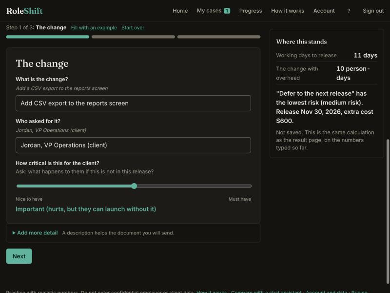

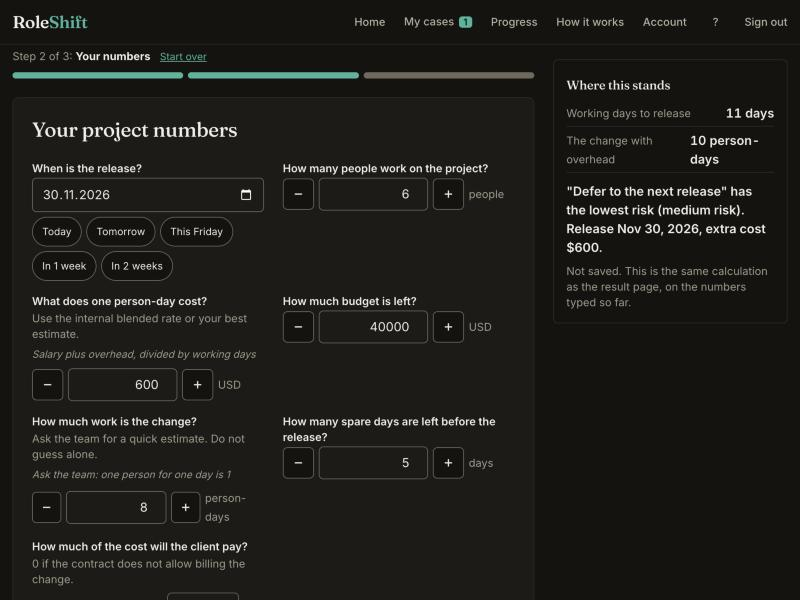

**Task and option cards.** Tasks and options are cards you add, reorder, collapse and remove. Choices inside a card are buttons, and ratings (for example 1 to 5 on a criterion) are sliders with a word (Poor ... Excellent).

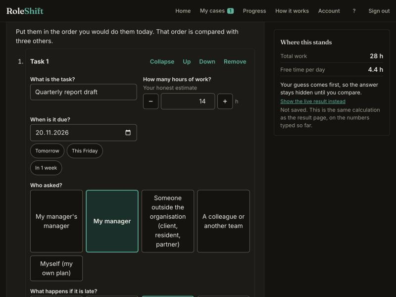

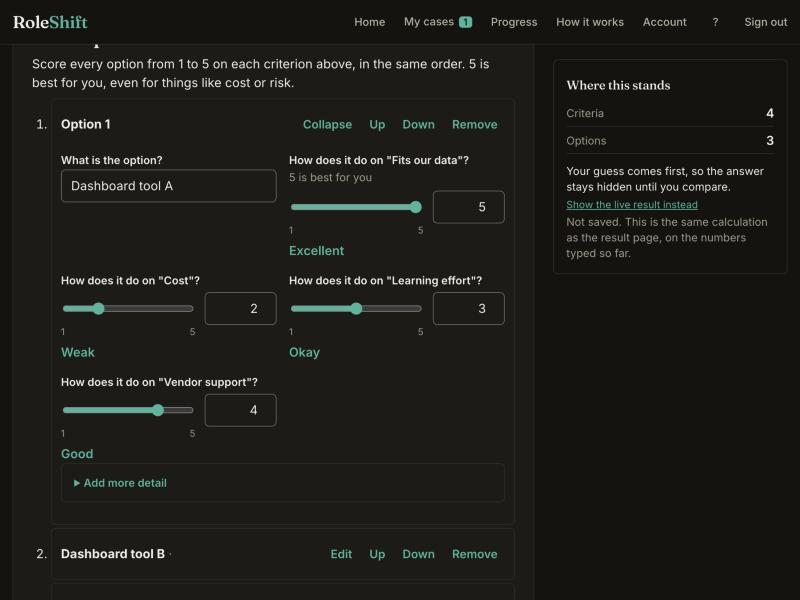

**The side panel "Where this stands"** updates while you type. It shows the numbers that follow from what you entered and what is still missing. For scenarios with a guess step it keeps the answer hidden so your guess stays honest; "Show the live result instead" reveals it. Nothing is saved.

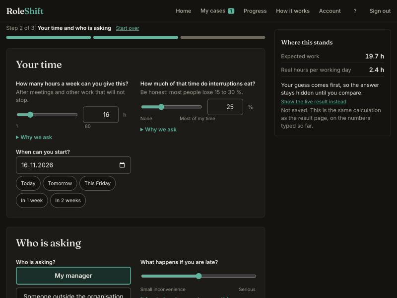

**Review** lists what you entered by step, with an **Edit** link for each. Then confirm you entered no confidential information and press **Compare my options**.

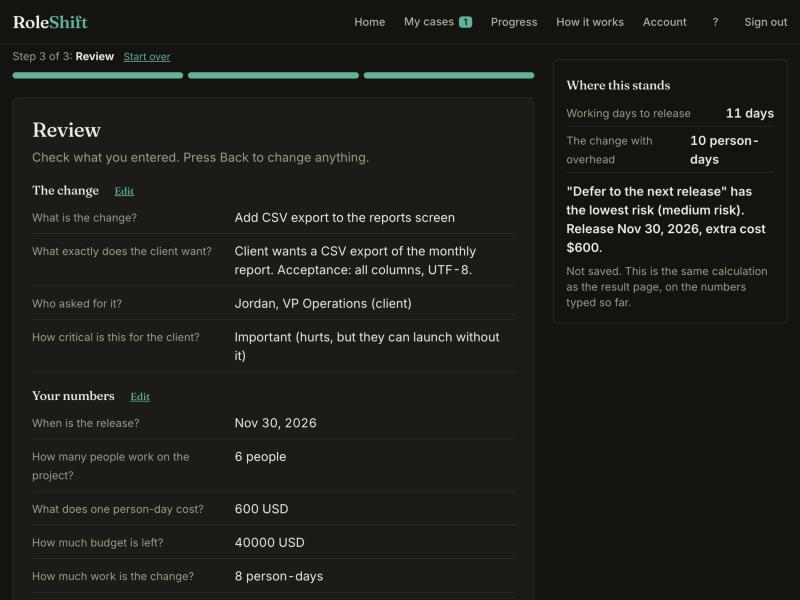

## 4. Guess first, then the numbers
For three scenarios (priorities, a deadline, choosing between options) a screen asks what you think the numbers will say. Answer, or press **Skip**. Afterwards the result page shows your guess next to the calculation, and **Progress** counts how often you matched it. This measures agreement with the calculator on your own numbers, not how good your decisions are in real life.

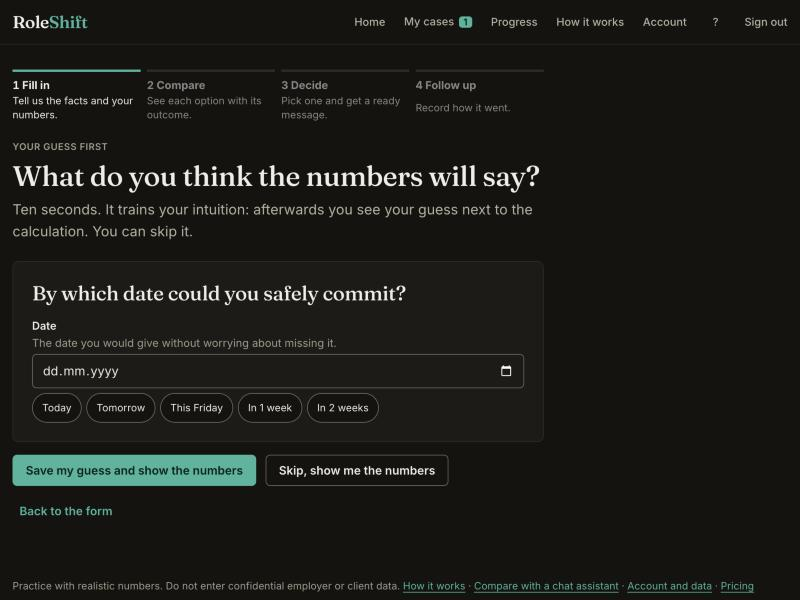

## 5. Read the result
At the top is a one-sentence answer, then one column per option with dates or costs, "What to watch" and a risk label. The label is a rule of thumb: **Why this label** lists the points, the thresholds, and a block "What counted in this label" for time, money and quality. If you entered money or scope inputs, a table **Time, money, quality** shows what each choice costs on the three axes.

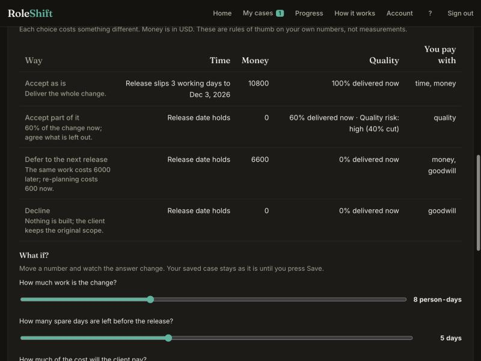

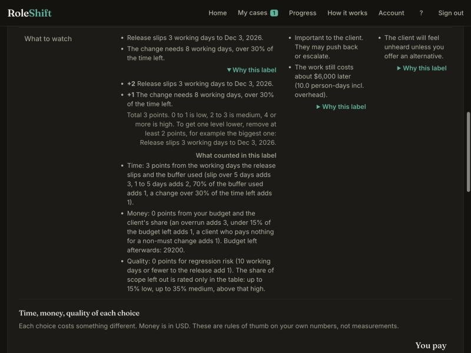

**What if?** (before you decide) lets you drag two or three of the numbers that move the outcome and see the answer change next to the saved one. Nothing changes until you press **Save these numbers**; **Reset** puts the sliders back. **Challenge my numbers** recalculates with worse numbers and says whether the conclusion still holds.

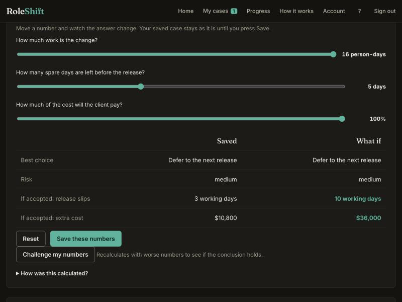

## 6. Decide and get the document
Choose an option, write your reason and press **Save decision**. You get a ready document (a Change Request, a priority proposal, an estimate reply or a decision note) that you can edit, copy or download as .md. The time, money, quality table stays on the page and is in the document. Check the facts before you send it.

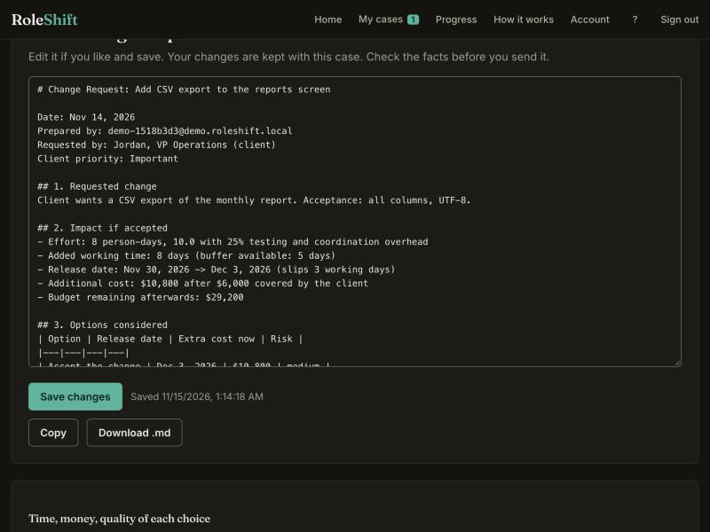

## 7. Record the outcome
Choose when to be asked "how did it go" and record the outcome later. The test site sends no email unless a mail service is connected. **Progress** shows the day out of 90, decisions made, confidence before and after, and how often your guesses matched the numbers.

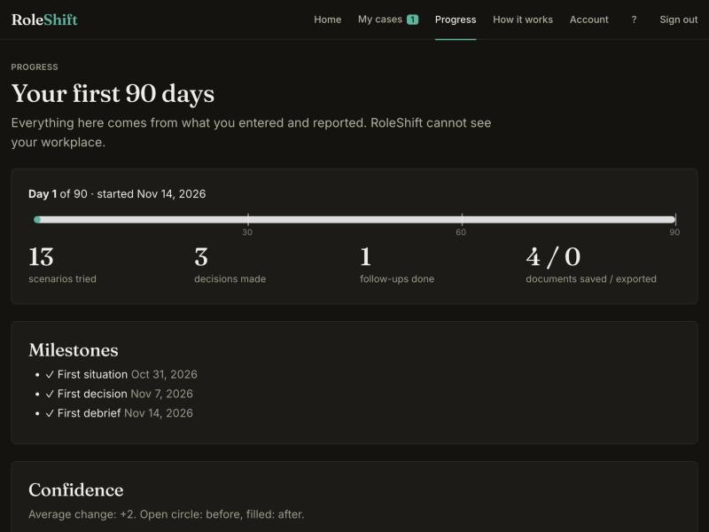

## Good to know
- Guided tips can be switched off ("Do not show tours again") and restarted in Account.
- Demo data is sample data and can be deleted; in your own account you are responsible for what you enter (see "Account and data").
- Free for 3 situations of your own, then a one-time pass for $19 with a test checkout (no real payment).
- Pages open on a phone, but the forms are built for a computer screen.
- For a short test plan and the correct answers to check, see [AGENT_GUIDE.md](AGENT_GUIDE.md).
