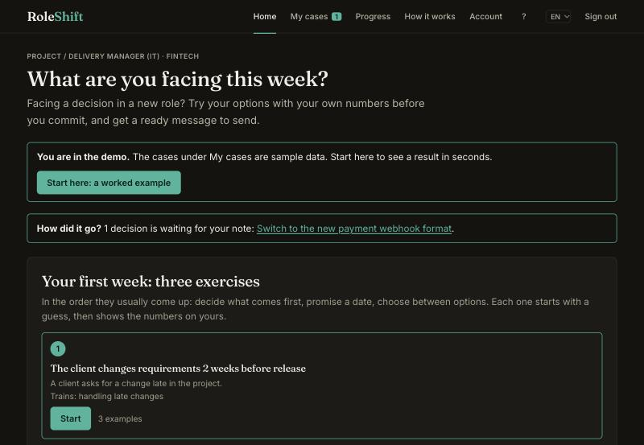
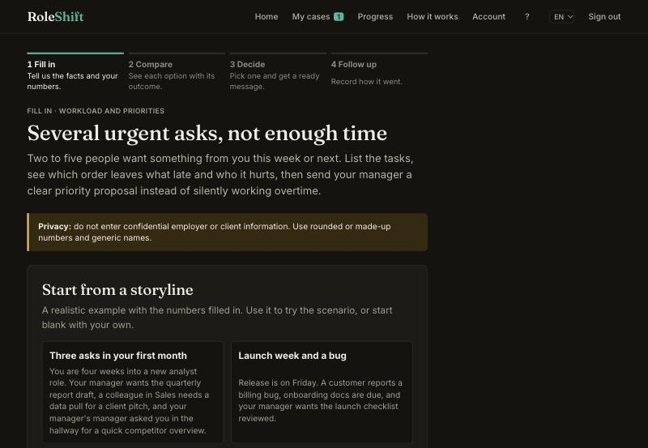
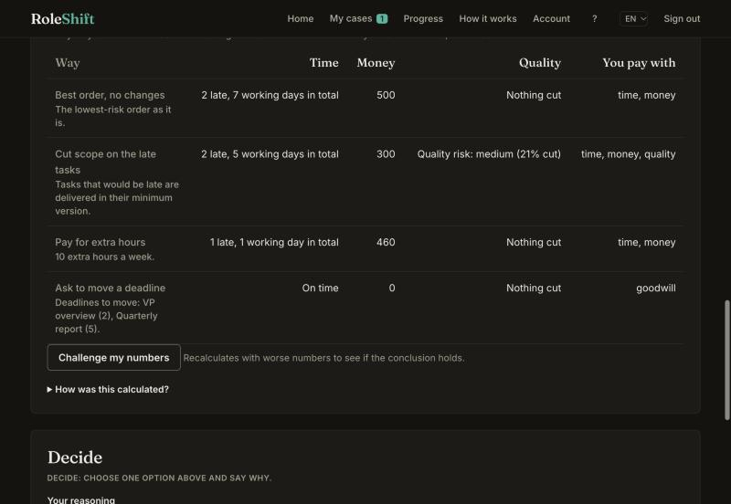
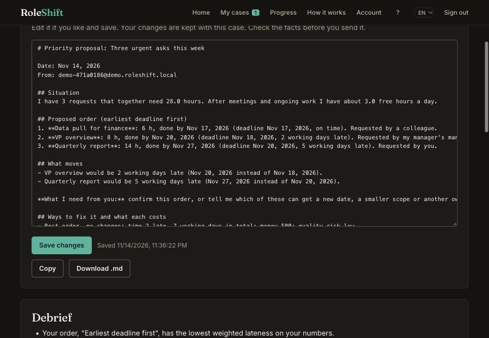
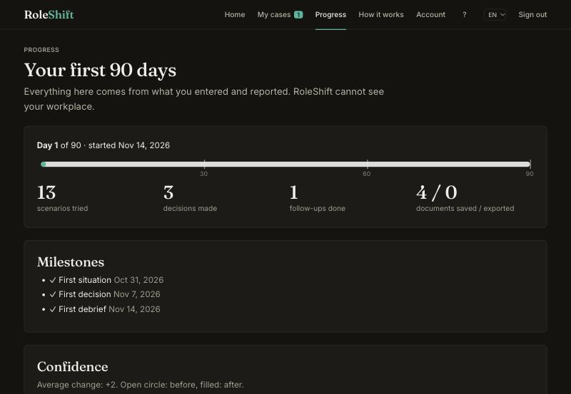

# RoleShift: как пользоваться

Тренажёр решений для тех, кого недавно повысили. Вы вводите **свои** цифры, сначала делаете **догадку**, потом видите расчёт, решаете, получаете готовое письмо или документ и позже записываете, чем всё кончилось. Расчёт детерминированный: это не прогноз и не совет, решение за вами.

Тестовый сайт: https://businesscup-2-0-zimran.vercel.app (язык переключается вверху справа: EN / RU / KZ).

## 1. Войти
Нажмите **«Try the demo»** на странице входа: откроется демо-аккаунт с примерами, регистрация не нужна. Для своего аккаунта: email и пароль, затем выберите свою должность и срок в роли (подбираются примеры и слова).

## 2. Выбрать ситуацию
На главной три упражнения «первой недели»: изменение от клиента, несколько срочных просьб, «когда будет готово?». Кнопка **«Start here: a worked example»** покажет результат за секунды. Не знаете, что выбрать? Опишите ситуацию своими словами в блоке «Describe your scenario».

## 3. Ввести свои цифры
Выберите готовую историю (storyline) или начните с пустой формы. Не вводите конфиденциальные данные работодателя или клиента: используйте округлённые и придуманные числа. Блок **«Money and quality (optional)»** можно оставить пустым: тогда расчёт идёт только по времени.

## 4. Догадаться, потом увидеть расчёт
Перед результатом можно угадать (сколько задач опоздает, какой порядок лучше, к какой дате вы смогли бы обещать). Можно пропустить («Skip»). После расчёта сервер сравнит догадку с цифрами, а во вкладке **Progress** копится ваша точность. Это согласие с калькулятором на ваших цифрах, а не оценка решений в жизни.

## 5. Прочитать результат
Сверху фраза «Best by the numbers». Ниже колонки-варианты: даты, опоздания, «What to watch» и метка риска (ориентир; «Why this label» показывает, как она получена). Если вы заполнили деньги и объём, появляется таблица **«Time, money, quality: what you pay with»**: каждый способ исправить опоздание (урезать объём, оплатить часы, перенести срок) стоит чем-то своим. Качество здесь оценивается по доле урезанного объёма (до 15% низкий риск, до 35% средний, больше высокий): это правило, а не измерение. Кнопка **«Challenge my numbers»** пересчитывает с худшими цифрами и показывает, устоит ли вывод.

## 6. Решить и получить документ
Выберите вариант, напишите причину и нажмите «Save decision…». Получите готовый документ (предложение руководителю, ответ по срокам, записка о решении) с таблицей «Ways to fix it and what each costs». Его можно править, скопировать или скачать .md. Проверьте факты перед отправкой.

## 7. Записать итог
Выберите, через сколько дней спросить «как прошло». При желании придёт письмо с ссылками «получилось / частично / ещё нет» (на тестовом сайте письма не отправляются, SMTP не подключён). На вкладке **Progress** видны дни из 90, число решений, уверенность до/после и навыки.

## Что стоит знать
- Подсказки-туры можно выключить («Do not show tours again»); вернуть их можно в Account.
- В демо данные примерные и стираются; в своём аккаунте вы сами отвечаете за данные: см. «Account and data».
- Бесплатно до 3 своих сценариев; дальше тестовая покупка без реальной оплаты.
- Казахский и русский тексты машинные и требуют проверки носителем.
- На бесплатном хостинге первый запрос после простоя может занять несколько секунд.
